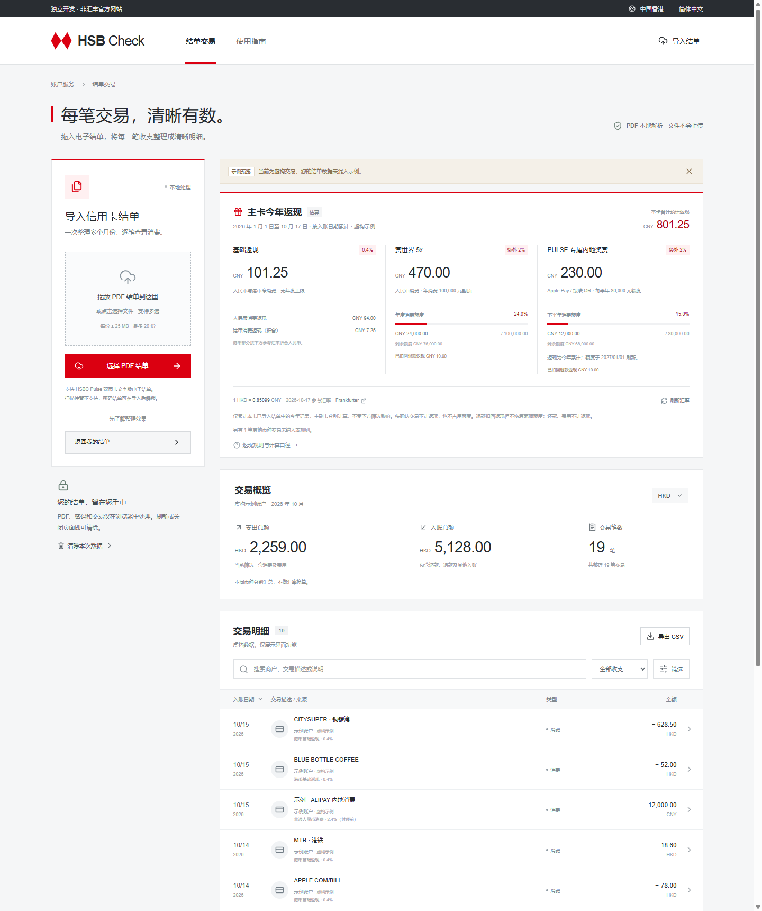

# HSB Check

**把 HSBC PULSE 信用卡 PDF 结单，整理成可核对、可筛选、可导出的交易明细。**

纯前端 · PDF 本地解析 · HKD / CNY 双币 · 主副卡返现估算

[在线体验](https://pulse.cbshuimu.net) · [快速开始](#快速开始) · [解析与返现规则](docs/rules.md) · [参与贡献](CONTRIBUTING.md) · [MIT](LICENSE)

> **AI 生成说明：本项目大部分代码由 AI 生成，并由维护者提出需求、调整和验证。** 解析结果和返现均可能存在错误，请与原始结单及银行实发记录核对。开发中使用 AI；应用运行时不调用 AI 服务。

## 看看整理效果



截图来自应用内「查看示例数据」，商户与金额均为虚构。无需提供结单即可先体验搜索、筛选和导出。

## 能做什么

| 从结单到明细 | 具体行为 |
| --- | --- |
| 导入与解锁 | 多份 PDF 逐页解析，支持密码结单；单份失败不影响其他文件 |
| 核对与追溯 | 按子账户核对结欠，保留原始文字、来源文件和页码，可打开原 PDF |
| 搜索与导出 | 按日期、币种、收支、类型、子账户与来源筛选，导出当前筛选的全部 CSV 记录 |
| 重复导入 | 同一结单按出现次数合并来源，保留同日同商户同金额的多笔消费 |
| 返现估算 | 主卡与每张副卡独立计算基础返现、赏世界 5x、PULSE 专属奖赏，支持支付方式修正 |

**当前适配 HSBC PULSE UnionPay 双币信用卡英文文字版电子结单。** 扫描件、图片不支持 OCR；其他银行、语言或版式未保证适配。每份最多 25 MB / 200 页，页面最多 20 份、合计 100 MB。结欠一致是核对线索，不能证明所有交易都已正确识别。

## 快速开始

需要 Node.js 22.12+，建议使用 `.node-version` 指定的 **22.22.0**，以及支持 Web Worker、Web Crypto 的现代浏览器。

```bash
npm ci
npm run dev
```

打开终端显示的本地地址，点击「查看示例数据」，或导入自己的结单。Web Crypto 需要 localhost 或 HTTPS 环境。

1. 拖入一份或多份 PDF；密码文件可在文件列表中输入密码后重试。
2. 查看每份文件的解析报告，处理无法识别行和结欠差额。
3. 搜索、筛选交易，打开详情核对原文；必要时修正返现支付方式。
4. 导出 CSV，或清除本次数据。**刷新页面会重置导入内容和手动修正。**

## 返现如何估算

按香港时间、本年已入账的导入记录统计，独立于交易列表筛选。以下是**代码当前实现的口径**，不代表银行最新活动条款或对个别交易的实际认定。

| 项目 | 估算规则 | 消费额度 |
| --- | --- | --- |
| 基础返现 | HKD / CNY 净消费 × 0.4% | 无上限 |
| 赏世界 5x | 人民币合资格消费额外 2% | 每卡每年 CNY 100,000 |
| PULSE 专属 | 有 Apple Pay / 明确 UnionPay QR 标记的人民币消费额外 2% | 每卡每半年 CNY 80,000 |

退款扣回返现但不恢复额度；待入账或支付方式待确认的记录暂不参与返现与额度计算。还款、费用和奖赏入账不计消费。港币基础返现使用公开 HKD/CNY 参考汇率折算成人民币，汇率不可用时不虚构折算结果。

详细的封顶、退款、主副卡归属、去重和解析边界见 [解析与返现规则](docs/rules.md)。

## 数据留在哪里

- **结单在浏览器内处理。** 无业务后端、银行授权、银行 API 或上传接口；不执行 PDF 内嵌 JavaScript。
- PDF、密码和解析文字不写入 localStorage、sessionStorage 或 Cookie；文件及结果保留在当前页面内存中。已导出的 CSV 由你自行管理。
- PDF.js、Worker、字体、CMap 和 WASM 随站点提供，无需第三方 CDN；首次导入时才加载解析器。
- 唯一的业务外部请求是 [Frankfurter 公开汇率](https://frankfurter.dev/) 的固定 HKD/CNY 查询，不携带账户、交易、PDF、凭据或来源页信息。页面加载和刷新汇率仍需要网络。
- 维护者站点启用了页面访问与性能统计，不向统计服务发送结单、密码或交易内容。
- 示例与测试均使用虚构数据。反馈问题时请勿附带真实结单、密码、完整卡号或持卡人资料。

## 构建与部署

```bash
npm test
npm run build
npm run preview
```

将 **整个 `dist/` 目录**部署到支持 HTTPS 的静态托管。构建会从 `pdfjs-dist` 复制解析支持文件到 `public/pdf-assets/` 并打包进 `dist/`，不要遗漏这些资源及其许可证。

如需自动部署，可使用 `npm ci` 安装依赖，以 `npm test && npm run build` 验证并构建，再发布 `dist/`。部署凭据应通过托管平台的密钥管理功能配置，不能写入仓库。

`package.json` 的 `private: true` 用于防止误发布到 npm，不影响 GitHub 仓库公开或静态站点部署。

### 使用 Docker 部署

安装并启动 [Docker](https://docs.docker.com/get-started/get-docker/)（Windows / macOS 使用 Linux 容器），在项目根目录执行：

```bash
docker build --pull -t hsb-check:local .
docker run -d --name hsb-check --restart unless-stopped -p 127.0.0.1:8080:80 hsb-check:local
```

打开 [http://localhost:8080](http://localhost:8080)。无需在宿主机安装 Node.js；镜像使用 Node.js 22.22.0 安装锁定依赖、运行测试并构建，再由 Nginx 提供完整的 `dist/`，包含 PDF.js Worker、字体、CMap、WASM 及许可证。首次构建需要联网下载基础镜像和 npm 依赖。

默认仅允许本机访问。服务器部署时，在宿主机通过 Nginx、Caddy 等反向代理将 HTTPS 域名转发到 `127.0.0.1:8080`，并在站点根路径 `/` 提供应用。容器内提供 HTTP；远程浏览器需通过 HTTPS 访问，才能使用 Web Crypto。若反向代理也在 Docker 中，可将两者接入同一 Docker 网络，代理到 `hsb-check:80`。

容器只提供静态网页，无需数据库、结单目录挂载或业务密钥；结单仍在浏览器内处理，刷新页面会清空本次数据。

查看运行状态与日志：

```bash
docker ps --filter name=hsb-check
docker logs hsb-check
```

更新代码后重新构建并替换容器：

```bash
docker build --pull -t hsb-check:local .
docker stop hsb-check
docker rm hsb-check
docker run -d --name hsb-check --restart unless-stopped -p 127.0.0.1:8080:80 hsb-check:local
```

停止并移除部署可执行 `docker stop hsb-check` 和 `docker rm hsb-check`。

## 代码导览

```text
src/
├── App.jsx               # 导入流程、文件状态、筛选和导出
├── pdf.js                # PDF.js 读取、密码处理和文字坐标提取
├── statements.js         # 表格解析、主副卡归属、结欠核对和去重
├── transactions.js       # 筛选、精确汇总和 CSV 转义
├── rewards.js            # 返现、退款和独立封顶额度计算
├── exchange-rate.js      # 公开参考汇率请求与校验
├── RewardsCard.jsx       # 返现概览和汇率状态
└── RewardAdjustment.jsx  # 支付方式与退款修正
tests/                    # Node.js 内置测试，夹具为虚构数据
docs/rules.md             # 解析规则与估算边界
```

测试覆盖坐标分行、金额与 CR、跨年跨页、主副卡、结欠差额、去重、CSV 公式转义、返现封顶与退款，以及汇率异常和请求隐私。贡献前请阅读 [贡献指南](CONTRIBUTING.md)。

## 许可与声明

项目采用 [MIT License](LICENSE)。第三方依赖保留各自许可证，PDF.js 许可证随生产资源分发。

这是独立开发的非官方工具，与 HSBC / 汇丰银行没有隶属、授权或背书关系。相关名称与商标归各自权利人所有。软件按现状提供，交易及返现结果请以原始结单和银行确认为准。
